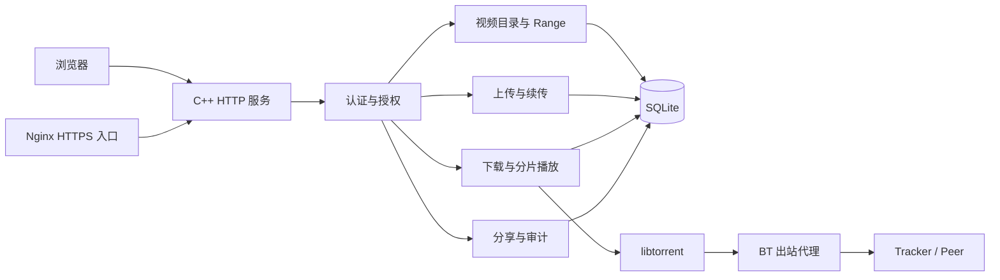

# 技术架构

## 模块关系

HTTP 服务使用 8 个工作线程、64 个排队任务。传输层在逐次读取超时之外限制完整请求头和请求体的接收时间，停止监听后中断等待中的连接。统一错误类型映射到 JSON 响应；日志按行输出 JSON。

认证模块验证当前账号状态和角色。敏感操作在事务内再次校验身份，媒体和分享读取按 64 KiB 写入重复检查权限及文件身份。前端通过 API 获取数据，权限判断由服务端执行。

文件模块逐级 `openat`，以 `O_NOFOLLOW` 拒绝符号链接。视频索引保存目录、设备、inode、大小和修改时间。BT 使用独立受控目录，其未完成文件不能通过普通媒体接口访问。

上传确认偏移对应已校验并 `fsync` 的数据；发布使用 `renameat2(RENAME_NOREPLACE)`。BT 流式读取对应完整分片的不可变校验快照，调度周期在焦点优先级和基准优先级之间切换。

远程适配层校验 HTTPS 入口；BT 出站代理独立配置。分享会话限制为单个视频，账号变化、期限或撤销均会终止授权。

## 数据表

|表|主要字段与用途|
|---|---|
|users|用户名、密码哈希、角色、禁用状态|
|sessions|令牌哈希、用户、到期时间|
|media|共享目录、相对路径、文件身份、大小、格式、时长|
|grants|视频与用户授权关系|
|history|用户、视频、播放位置、更新时间|
|uploads|所有者、目录与暂存身份、分块哈希、确认偏移、期限、发布状态|
|tasks|所有者、目录、名称、info hash、暂停状态、恢复数据|
|bt_history|用户、任务、文件、播放位置|
|shares|令牌哈希、视频、签发者、期限、撤销状态|
|share_sessions|专用会话哈希、分享对象、期限|
|settings|共享及下载目录、加密代理配置、初始化标记|
|audit|时间、操作者、事件和对象信息|

数据库使用 WAL、外键和预编译参数绑定。单连接由递归锁保护，事务在提交前持有锁。账号、媒体和分享删除通过关联约束与明确的失效操作处理。

## API 分组

|功能|接口|
|---|---|
|健康与身份|`/api/health`、`/api/bootstrap/status`、`/api/login`、`/api/logout`、`/api/me`、`/api/password`|
|账号管理|`/api/users`、`/api/users/:id`、`/api/users/:id/password`|
|视频与历史|`/api/media`、`/api/media/root`、`/api/media/scan`、`/api/media/:id/grants`、`/media/:id`、`/api/history`|
|上传|`/api/media/upload`、`/api/uploads`、`/api/uploads/:id`、`/api/uploads/:id/chunk`、`/api/uploads/:id/complete`|
|BT|`/api/torrents`、`/api/tasks`、任务暂停/恢复/重校验/移除、`/bt/:id/file/:index`、BT 播放历史及焦点接口|
|代理|`/api/proxy`、`/api/proxy/test`、`/api/bt/config`|
|远程与分享|`/api/remote`、`/api/remote/test`、`/api/shares`、`/api/shares/:id`、`/share/api/exchange`、`/share/media`|
|管理监控|`/api/admin/status`、`/api/admin/audit`|

精确方法、参数与错误码见对应的认证、媒体、上传、BT 和远程文档。

## 工程目录

`include/` 与 `src/` 保存服务端模块；`web/` 保存浏览器资源；`tests/` 保存集成夹具及浏览器测试；`scripts/` 提供构建、客户端、部署配置和打包工具；`deploy/` 保存部署模板；`docs/` 保存说明、许可通知和测试记录。
