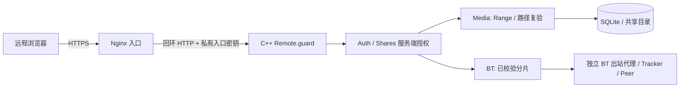

# 阶段 6：HTTPS 入口与单视频分享

## 实现与验证范围

已经实现可替换 `AccessAdapter` 接口及 LocalAccess / ReverseProxyAccess 两个实现；独立 Nginx 终止 HTTPS，C++ 只监听同机回环 HTTP。通过真实本机 Nginx、TLS、C++ 客户端和 Chromium 验证传输、播放、拖动、到期、撤销及故障恢复。公网域名、跨设备访问、公共证书续期和跨 NAT 尚未实测。当前没有 STUN、协调服务器、UDP 打洞或自建公网中继实现。



BT 出站代理影响下载方发出的连接；反向代理接收浏览器连接、终止 TLS 并转发给本机 C++ 服务；公网中继需要另一台可达主机与认证隧道。本实现提供反向代理适配，**反向代理配置本身不能穿过一个没有端口映射、隧道或可达入口的 NAT**。如果服务器只有私网地址，需要运营者已有的网络映射/VPN/认证隧道，或另行部署和验证公网中继，不能把获取公网 IP 当作穿透完成。

## 运行模式与连接失败

- `LANVIDEO_REMOTE_MODE=local`：默认模式，可本机/可信局域网 HTTP 演示。默认 bind 为 127.0.0.1。设置公开 origin 只影响已有会话策略，不会自动启用代理。
- `LANVIDEO_REMOTE_MODE=reverse_proxy`：必须 `LANVIDEO_BIND=127.0.0.1` 且设置无路径 HTTPS 的 `LANVIDEO_PUBLIC_ORIGIN`。生成或复用 `LANVIDEO_DATA/ingress.key`，64 字符随机密钥，0600、单硬链接、当前用户所有、非符号链接；不会把密钥输出到日志、命令行或配置示例。仅公开健康检查不要求入口密钥，其余页面与接口均须私有入口证明。
- 入口必须覆盖 `X-Lanvideo-Ingress`、`X-Forwarded-Proto=https`、`X-Forwarded-Host` 和 `X-Real-IP`。C++ 验证来源回环 IP、单一头部、恒定时间密钥比较、HTTPS/host 和 IP 格式。登录限流仅在此边界验证后使用代理覆盖的实际客户端地址；本地模式继续使用 TCP 来源。畸形 Range 在 httplib 路由前拒绝的路径也验证入口，不能绕过检查。
- `GET /api/remote` 管理员读取当前适配与最近探测；`POST /api/remote/test` 管理员 + CSRF，请求 `{}`，只探测启动配置的 HTTPS origin，没有任意目标探测 API。连接/读/写超时各 2 秒，响应限制 4 KiB，不跟随重定向，校验证书链与域名，再核对随机 nonce 和本进程实例身份。5 秒内重复探测返回 429。可选 `LANVIDEO_REMOTE_CA` 为绝对 CA 文件路径；空值使用系统 CA；没有关闭 TLS 校验的产品选项。
- 结果区分 `local_only`、`reachable`、`connection_error`、`tls_error`、`entry_mismatch`。这只是服务所在机器到配置入口的探测，不能证明外部客户可达或跨 NAT 成功。
- 代理断开时，远程请求失败，后端数据接口继续拒绝直接 HTTP。不重定向、不携带令牌自动降级 HTTP。恢复代理可以恢复原授权；如确实需要局域网回退，管理员从终端**停止后端、明确改为 local 模式并重启**，再用本地连接登录。跨公网不能采用此回退。

## 可部署的同机 Nginx 配置

使用自己的域名、可达机器及适用的完整证书链/私钥。下面示例中的保留域名和路径需要替换，不包含真实密码或密钥。软件不申请证书、不改变防火墙/路由、不绑定未经授权的公网服务。

```sh
cd /workspace/LANVideoServer
# 现有 var 默认 0700；其他数据目录也必须为私有非符号链接目录。
# 先通过 --init-admin 创建自己的管理员；已初始化时不要重复执行。
./build/lanvideo --init-admin
python3 scripts/configure-remote.py \
  --data /workspace/LANVideoServer/var \
  --output /workspace/LANVideoServer/var/nginx.conf \
  --origin https://video.example.com:8443 \
  --cert /absolute/path/fullchain.pem \
  --key /absolute/path/privkey.pem \
  --upstream-port 8080 --listen 0.0.0.0 --upload-mib 512
# 生成文件含入口密钥，权限0600，禁止提交、cat 到日志或公开转发。
# 既有输出文件拒绝覆盖。需要修改时生成到新文件、校验后由运营者替换。
export LANVIDEO_REMOTE_MODE=reverse_proxy
export LANVIDEO_BIND=127.0.0.1
export LANVIDEO_PORT=8080
export LANVIDEO_PUBLIC_ORIGIN=https://video.example.com:8443
export LANVIDEO_DATA=/workspace/LANVideoServer/var
bash scripts/run.sh
# 在另一个终端，以相同运行用户启动独立代理；这两个进程都需监管。
/workspace/toolchain/sysroot/usr/sbin/nginx -t \
  -p /workspace/LANVideoServer/var/ -c /workspace/LANVideoServer/var/nginx.conf
/workspace/toolchain/sysroot/usr/sbin/nginx \
  -p /workspace/LANVideoServer/var/ -c /workspace/LANVideoServer/var/nginx.conf
```

系统已安装 Nginx 时可替换为系统可执行路径，测试可设 `LANVIDEO_NGINX=/absolute/path/nginx`。生成配置是独立单进程、前台示例，适合演示和 systemd 等监管器；非系统 `/etc/nginx` 的自动修改。8443 允许普通用户监听；使用443需要运行平台提供绑定权限或外部端口映射。TLS 证书的域名必须匹配 origin；自签证书只用于隔离测试，正式外网需要客户端信任的证书链。证书管理与续期由运营者承担。

生成配置启用 TLS1.2/1.3，禁用 session tickets；应用设置 HSTS（仅此域名，不含 includeSubDomains）、CSP、no-store、nosniff、no-referrer 和 DENY 框架。关闭访问日志，错误日志不主动记录请求体/认证头；分享令牌不放在请求 URI。设置连接/请求超时、worker connections 128、每来源16个连接和上传大小上限；C++ 工作线程/队列及分路由上限仍生效。所有临时目录位于私有数据目录，无需向系统路径写入。代理 request/response buffering 关闭；上传仍须有效 Content-Length，Range 保留至应用处理。

**同机信任边界**：运行用户、入口密钥、代理配置及主机管理员属于信任域。获得密钥的本机进程能够假冒入口；此方案不是对主机入侵的防御。反向代理部署到不同机器时不能把后端裸露到公网，需替换为认证加密链路并重新验证；当前适配明确只支持同机代理。

## 分享协议、权限范围和持久化

管理员在视频卡片点击「分享」或在管理页面输入视频编号、选择期限，创建后复制链接；接收者访问单独的 `/share` 播放页。普通用户只操作已授权库与自己的任务，不能签发/列举/撤销分享。分享暂不支持 BT 未完成分片，仅覆盖完整媒体目录资源。

|接口|授权 / 行为|
|---|---|
|`POST /api/shares`|管理员 + CSRF；JSON `{media_id,ttl_seconds,scope:"video_read"}`；TTL30..604800秒；返回201及一次性原始链接|
|`GET /api/shares`|管理员；最近200条元数据，不返回原始令牌/令牌哈希|
|`DELETE /api/shares/:id`|管理员 + CSRF；永久撤销并删除对应播放会话，可重复撤销|
|`POST /share/api/exchange`|JSON `{token}`；有效持有者换取专用 `lv_share` HttpOnly/SameSite=Strict cookie；HTTPS模式为Secure；Path=/share/|
|`GET /share/api/info`|专用分享会话，仅一个视频的公开信息和到期时间，不含服务端路径|
|`GET/HEAD /share/media`|同一会话固定视频；不接受 ID/path/query 覆盖；200/206/416、缺失404、变更409；每个输出块复验|

分享令牌随机256bit，DB只存 SHA256；URL为 `/share#<token>`，片段不会发送至服务器/Nginx，页面脚本先移除片段，再通过JSON POST交换。链接只在创建时返回，不能从DB/列表取回。分享播放会话另生成随机256bit且只存哈希，期限为链接剩余期限与1小时的较小者。超过1小时须重新打开原始分享链接，而非用主账户权限自动延长。原始链接持有者可转交他人；`video_read` 表示单个视频字节读取，**不能阻止接收者保存视频**，没有伪称的禁止下载/DRM权限。

`shares(id,media_id FK,creator FK,token_hash UNIQUE,scope,created,expires,revoked)`；`share_sessions(token_hash PK,share_id FK,expires)`，均写SQLite/WAL，媒体或签发者删除级联删除。签发者禁用、角色变更、改/重置密码会永久撤销其链接及播放会话；重新启用账号不会恢复旧链接。文件重扫导致ID更换、共享根目录变更、路径替换或符号链接均停止旧授权。对目录和文件保留原有 openat/O_NOFOLLOW 与 inode/device/size/modified 校验，并在输出前重新打开路径复验。

最多1000个未过期有效链接、单链接64个未过期播放会话、全局4096个会话；新交换/启动清理过期播放会话。没有全局后台过期记录清理、用户磁盘配额或收件人身份名单。关键操作日志只存签发者/视频/分享编号、到期时间及状态，不存密码、令牌、cookie或入口密钥。不要把生成配置或浏览器含令牌的地址截图用于公开说明书。

撤销/到期后新请求立即失败；已开始的响应在下一次最多64KiB输出检查时中断，响应头发出后不能改成错误JSON。内核/网络/浏览器已缓冲的数据无法追回。分享页面每5秒查询授权，并在发现失效后清空播放器；已经交付的字节不能靠撤销删除。匿名无会话401；失效会话/令牌统一404；无效输入400/415；越权或跨origin403；会话额度429。页面不会用分享 cookie 登录主系统，也不读取账号播放记录。

## 重复运行验证

```sh
/workspace/toolchain/venv/bin/cmake --build build -j2
/workspace/toolchain/venv/bin/ctest --test-dir build \
  -R 'shares_integration|remote_integration|browser_remote' --output-on-failure
```

测试生成临时视频、随机密码/密钥和临时TLS证书，启动真实C++/Nginx进程并停止清理，不修改实际 var 中的用户。分享测试真实等待30秒到期，并在大文件持续读取时撤销；TLS测试验证可信链成功、不可信链和错误域名失败、错误应用和302不跳转、入口头部覆盖与直连拒绝、停机恢复及显式本地回退。Chromium隔离夹具只信任本次生成叶证书的SPKI；未设置 blanket ignoreHTTPSErrors，未修改正式浏览器信任。当前容器浏览器沙箱 helper 不可用，只对本机夹具关闭并拦截外部请求。C++/Python证书链与主机名校验在正负测试中始终开启。

实际测试数量与最新测量见 [stage6-test-results.json](stage6-test-results.json)、[remote-browser-evidence.json](remote-browser-evidence.json)，截图在 build/Testing/artifacts/remote-share-player.png。这些是单机小样本，不代表公网吞吐、全浏览器兼容或安全等级。
